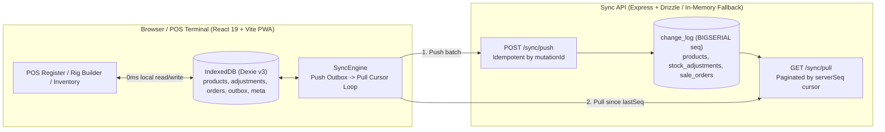

# MegaHertz Depot — Offline-First PC Hardware POS & Custom Rig Builder

**MegaHertz Depot** is a local-first Progressive Web App (PWA) Point-of-Sale (POS), Custom PC Rig Configurator, Warranty/Serial Number Tracker, and Multi-Terminal Inventory Synchronization system built for computer hardware stores.

Every action—ringing up component sales, capturing individual CPU/GPU/Motherboard serial numbers (`S/N`), building custom gaming rigs with live socket/DDR/PSU wattage checks, printing official receipts or build quotes, and counting shelf stock—reads and writes directly to **IndexedDB (`Dexie.js`)** on the device. When internet connectivity returns, an idempotent outbox and monotonic cursor sync engine reconciles all cashier terminals automatically.

---

## Core Capabilities

1. **POS Register & Instant Offline Checkout (`PosRegisterPage`)**
   - Category pills (`CPU`, `Motherboard`, `GPU`, `RAM`, `Storage`, `PSU`, `Case`, `Cooling`, `Monitor`, `Peripheral`) and instant search by model, brand, SKU, socket (`AM5`, `LGA1700`), or RAM type (`DDR5`, `DDR4`).
   - **Per-Unit Serial Number (`S/N`) Capture:** Attach manufacturer serial numbers to individual line items at checkout for RMA & warranty verification.
   - **Flexible Tax & Discounts:** Philippine Peso (`₱` default, configurable currency), `12% VAT` (`Inclusive` or `Exclusive` toggle), fixed (`₱`) or percentage (`%`) discounts, and `Cash | GCash | Maya | Card | Split` tenders.
   - **Atomic Offline Checkout:** Completing a sale writes an immutable `SaleOrder` (`order.create`) and atomically records `-qty` (`reason: 'sale'`) stock adjustments in a single IndexedDB transaction.
2. **Custom PC Rig Builder & Compatibility Engine (`PcBuilderPage`)**
   - Interactive 8-slot rig configurator (`CPU`, `Motherboard`, `RAM`, `GPU`, `Storage`, `PSU`, `Case`, `CPU Cooler`) plus quick-start **AM5** and **LGA1700** gaming presets.
   - **Real-Time Compatibility & Wattage Analyzer (`analyzePcBuildCompatibility`):**
     - Verifies **CPU Socket vs. Motherboard Socket** (`AM5` vs `LGA1700`).
     - Verifies **Motherboard RAM generation vs. RAM Kit generation** (`DDR5` vs `DDR4`).
     - Calculates **Estimated System Peak Wattage** (base board/fans + component TDPs) with a recommended **1.25x PSU headroom** warning or error if the selected PSU capacity is exceeded.
   - **1-Click Quote or Checkout:** Generate a printable **PC Build Quotation** or load the entire rig directly into the **POS Register Cart**.
3. **Sales History & Warranty / Serial Number Lookup (`SalesOrdersPage`)**
   - Instant offline search by **Receipt # (`MHD-...`)**, **Customer Name**, **Component SKU**, or **Serial Number (`S/N`)** for fast RMA/warranty claims.
   - Re-open any receipt to print or download the Official Receipt & Warranty Slip.
4. **Hardware Inventory & Quick Shelf Count (`InventoryPage`, `QuickCountPage`)**
   - Full CRUD for PC hardware SKUs including compatibility specs (`socket`, `ramType`, `wattage`), retail/cost pricing, and warranty terms.
   - 1-click **"Seed 14 Sample PC Components"** button to populate realistic AMD/Intel CPUs, motherboards, GPUs, RAM, SSDs, PSUs, cases, coolers, and peripherals.
   - **Oversold / Backorder Alerts (`stock < 0`):** Never blocks an offline cashier sale; if two offline terminals sell the last GPU concurrently, stock deltas sum to `-1` and surface an explicit `OVERSOLD / BACKORDER` badge upon sync.

---

## Architecture & Multi-Cashier Conflict Resolution



| Entity / Operation | Conflict Strategy | Why It Works for Multi-Cashier Hardware Stores |
| :--- | :--- | :--- |
| **POS Sale Orders (`order.create`)** | **Append-Only Immutable Receipt** | Offline checkouts never block. Each order locks in the snapshot unit price, tax, discount, and serial numbers at the moment of sale. |
| **Stock Levels (`adjustment.create`)** | **Commutative Delta Summation (`SUM(delta)`)** | Every sale (`-qty`), restock (`+qty`), and physical shelf count (`counted - localStock`) is an append-only delta. Concurrent sales on Terminal A and Terminal B commute (`10 - 1 - 1 = 8`). |
| **Catalog Metadata & Price (`product.update`)** | **Per-Field HLC Last-Write-Wins (`nameHlc`, `skuHlc`, `priceHlc`)** | Updating a GPU's retail price on Terminal A and its SKU or specs on Terminal B merges cleanly field-by-field using lexicographically sortable Hybrid Logical Clocks (`<wallMs15>:<counter6>:<nodeId>`). |
| **Product Deletion (`product.delete`)** | **Tombstone (`deletedAt`, `deletedHlc`)** | Deletes are soft tombstones so offline terminals learn about discontinued SKUs via `/sync/pull`. |

---

## Quick Start & Verification

### 1. Install & Build All Packages
```powershell
npm install
npm run build
```

### 2. Run Unit & Convergence Tests (Vitest)
```powershell
npm test
```
Runs 32+ automated tests across `@countwise/shared` (HLC monotonic clock, LWW conflict resolver, 3-device offline convergence, PC build socket/DDR/PSU compatibility), `@countwise/server` (auth, store isolation, idempotent `/sync/push`, cursor `/sync/pull`, `order.create`), and `@countwise/client` (IndexedDB schema v1->v2->v3 migrations, sample catalog seeding, atomic POS sale stock deduction).

### 3. Start the Full Stack Locally
No PostgreSQL setup is required for local development—the server automatically activates its zero-config **in-memory sync store** when PostgreSQL is not running.
```powershell
# Terminal 1: Start Sync API Server on http://localhost:4000
npm run dev -w @countwise/server

# Terminal 2: Start Vite PWA Client on http://localhost:5173
npm run dev -w @countwise/client
```
Or launch the client alone and click **"Try Instant Offline Workspace (No Server Required)"** on the login screen.
